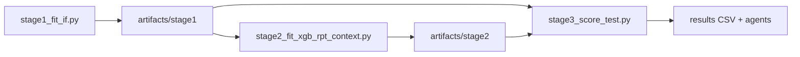
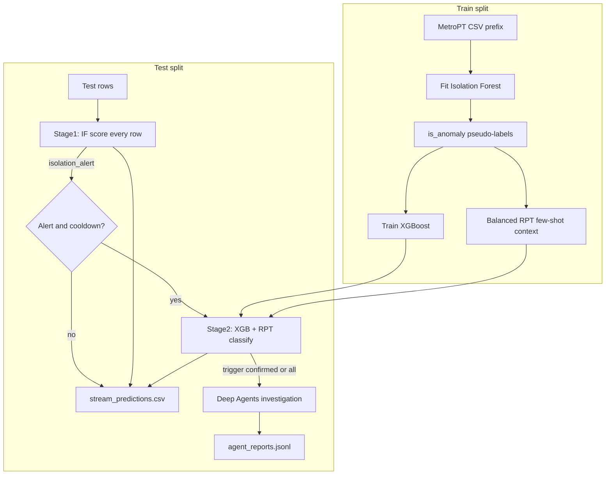

# MetroPT two-stage anomaly demo: IF → XGBoost vs SAP RPT 1.6

## Overview

Chronological **train / test** split on MetroPT-3 telemetry (replay, not live hardware). The pipeline is split into three scripts (plus a one-shot orchestrator):

1. **`stage1_fit_if.py`** — Fit Isolation Forest; write `is_anomaly` pseudo-labels and the frozen train/test split.
2. **`stage2_fit_xgb_rpt_context.py`** — Train **XGBoost** on stage-1 labels; build **balanced RPT** few-shot context (RPT is not a saved model — only context rows).
3. **`stage3_score_test.py`** — On test: IF scores every row (detector); on alerts, **XGB + SAP RPT** classify; optional **Deep Agents**.





`--max-rows` is a **percentage** of the CSV (chronological prefix). Example: `--max-rows 1` ≈ first 15k of ~1.5M rows.

Deep Agents do not change detection, pseudo-labeling, or RPT classification (see [Deep Agents add-on](#deep-agents-add-on)).

## Setup (PowerShell)

```powershell
uv venv
.\.venv\Scripts\Activate.ps1
uv pip install -r requirements.txt
$env:OPENAI_API_KEY="YOUR_KEY"   # only needed if you enable --agents
```

Configure SAP RPT as you did for your DataCo / gen_ai_hub setup. Place `MetroPT3(AirCompressor).csv` in this folder ([UCI MetroPT-3](https://archive.ics.uci.edu/dataset/791/metropt%2B3%2B)), or pass `--csv`.

## How to run

### One-shot (orchestrator)

Same flags as before; runs all three stages:

```powershell
python stream_demo.py --mock-rpt --max-rows 1 --cooldown 1
python stream_demo.py --max-rows 1 --cooldown 1 --context-size 64
```

### Three-step (artifacts on disk)

```powershell
python stage1_fit_if.py --max-rows 1 --train-fraction 0.6
python stage2_fit_xgb_rpt_context.py --context-size 64
# Optional RPT tuning experiments (re-run eval_stage2_metrics.py after):
# python stage2_fit_xgb_rpt_context.py --context-size 128 --context-neg-frac 0.55
# python stage2_fit_xgb_rpt_context.py --rpt-top-features 8
python stage3_score_test.py --mock-rpt --cooldown 1
```

Live RPT on stage 3:

```powershell
python stage3_score_test.py --cooldown 1 --agents --max-agent-reports 2 --agent-trigger confirmed
```

Do **not** re-sample or re-split in stages 2–3; they always reload `artifacts/stage1` so the chronological split stays fixed.

### Stage-2 test metrics (accuracy + confusion matrix)

After stages 1–2 exist, score the **held-out test** set. Reference label = **IF alert** (pseudo-label), not official failure events.

- **XGBoost**: every test row  
- **RPT**: all test rows, or `--max-rpt-rows N` (includes **all IF alerts** first, then spaced normals — not only the first N rows)

```powershell
# Quick check (mock RPT echoes IF — RPT metrics will look perfect by design)
python eval_stage2_metrics.py --mock-rpt --max-rpt-rows 200

# Live RPT on a capped balanced subset (recommended)
python eval_stage2_metrics.py --max-rpt-rows 200

# Full test live RPT (can be slow / costly)
python eval_stage2_metrics.py
```

Prints accuracy + CM for XGB on all test rows, then a **head-to-head** XGB vs IF and RPT vs IF on the **same successful RPT rows**, plus XGB↔RPT agreement. JSON: `results/stage2_metrics.json`; shared-row preds: `results/stage2_metrics_rpt_rows.csv`.

#### Live RPT: `--context-size` 64 / 96 / 128

Rebuild stage 2, then re-run `eval_stage2_metrics.py --max-rpt-rows 200`. Reference = IF alert on the **same successful live RPT rows** (API failures drop some of the 200). Current artifacts use **context-size 64** (32 pos / 32 neg).

| Setting | Shared rows | RPT vs IF | CM (TN / FP / FN / TP) | Notes |
|---|---:|---:|---|---|
| `--context-size 64` | 147 | **96.6%** | 71 / 5 / 0 / 71 | Best so far (CLI default) |
| `--context-size 96` | 141 | **96.5%** | 66 / 5 / 0 / 70 | Flat vs 64 |
| `--context-size 128` | 107 | **96.3%** | 48 / 4 / 0 / 55 | No gain; fewer successful API rows |

On matched rows, XGBoost vs IF stayed ~98%; XGB↔RPT agreement tracked RPT. Larger context alone did not beat **64**.

```powershell
python stage2_fit_xgb_rpt_context.py --context-size 64
python eval_stage2_metrics.py --max-rpt-rows 200
```

### Decision-support UI (React)

Replays `artifacts/stage1/test.csv` through the same scorer as stage 3, streams rows over WebSocket, and shows agent reports as decision cards.

1. Build artifacts once (stages 1–2, or a full `stream_demo` run).
2. Start the API (from `metropt_stream_demo`):

```powershell
uv pip install -r requirements.txt
uvicorn score_server:app --reload --port 8000
```

3. In another terminal, start the UI (**must** be inside `metropt_stream_demo`, not the repo root):

```powershell
cd C:\Users\I747069\Downloads\Tinker_SCM\metropt_stream_demo\ui
npm install
npm run dev
```

Open http://localhost:5173 — **Start stream**. Uses **live SAP RPT** (no mock toggle). Agents on by default (confirmed, capped). Requires SAP RPT credentials and `OPENAI_API_KEY` when agents are enabled (otherwise leave agents unchecked).

If `uvicorn` fails with “Access is denied”, use the module form from `metropt_stream_demo`:

```powershell
cd C:\Users\I747069\Downloads\Tinker_SCM\metropt_stream_demo
python -m uvicorn score_server:app --reload --port 8000
```

UI shows: live sensor chart, IF threshold, IF/XGB/RPT badges, alert list, and a priority + SUMMARY / EVIDENCE / checks / limitations panel when an agent report arrives.

#### Max agents

**Max agents** (UI control / `--max-agent-reports`) caps how many Deep Agents investigations run in one stream. After the cap, later confirmed alerts still appear in the alert list and still get IF/XGB/RPT scores, but no new LLM report is requested (`skipped_max`). Use it to limit cost and latency.

#### Decision support — Priority

The **Priority** badge is the agent’s `PRIORITY` field (decision support only — not a confirmed plant command). Allowed values:

| Priority | Meaning |
|---|---|
| `monitor` | Watch the asset; no urgent action suggested |
| `review` | Human should look soon; not treated as an emergency |
| `urgent_review` | Escalate quickly through site SOPs / qualified staff |

**`review`** means “worth operator or maintenance attention,” not “confirmed failure” and not “shut down now.” The agent is instructed not to invent certainty from IF / XGBoost / RPT agreement alone (those use Isolation Forest pseudo-labels).

If you see the word twice (large badge and again under report sections), it is the **same** priority shown twice, not two different levels.

### Artifacts

| Path | Contents |
|---|---|
| `artifacts/stage1/meta.json` | features, threshold, contamination, split sizes, CSV path |
| `artifacts/stage1/imputer.joblib` | median imputer |
| `artifacts/stage1/isolation_forest.joblib` | fitted IF |
| `artifacts/stage1/train_labeled.csv` | train rows + `is_anomaly` |
| `artifacts/stage1/test.csv` | held-out test rows |
| `artifacts/stage2/xgboost.joblib` | fitted XGB |
| `artifacts/stage2/rpt_context.csv` | balanced few-shot rows for RPT |
| `artifacts/stage2/xgb_feature_importance.csv` | gain importances |

| Flag | Role |
|---|---|
| `--max-rows` | Percent of CSV to keep (chronological prefix) |
| `--train-fraction` | Train share of that prefix (default `0.6`) |
| `--artifacts` | Root directory (default `artifacts/`) |
| `--cooldown` | Min test rows between stage-2 calls (default `30`) |
| `--cooldown 1` | Stage 2 on **every** IF alert |
| `--context-size` | RPT few-shot rows (default 64; try 96–128) |
| `--context-neg-frac` | Share of context that is IF-normal (default 0.5) |
| `--context-selection` | `spaced` (default) or `boundary` (experimental) |
| `--rpt-top-features` | Top-N XGB-gain sensors for RPT (`0` = all, default) |
| `--mock-rpt` | Fake RPT that echoes IF; XGB still real |
| `--agents` | Optional Deep Agents on selected stage-2 events |

Optional: `--csv path\to\file.csv`, `--sleep 0.02` to pace live calls. See [Deep Agents](#deep-agents-add-on) for agent flags.

### Reading the summary

Example after a live run with `--cooldown 1`:

```text
Stage1 IF alerts=93 | Stage2 calls=93
Stage2 agreement | XGB vs IF=98.9% | RPT vs IF=100.0% | RPT vs XGB=98.9%
```

- **Stage1** = all IF flags on test.
- **Stage2 calls** = alerts that got XGB+RPT. With default cooldown this is **less** than Stage1 (cost control). With `--cooldown 1` they match (if no missing features / RPT errors).
- **XGB vs IF** high is expected: XGB was trained on IF pseudo-labels.
- **RPT vs IF / RPT vs XGB** measure whether live RPT **confirms** the IF flag. Class-balanced few-shot context is required so RPT does not collapse to always predicting `0`. Agreement is **not** failure-event truth.

### Outputs

**Predictions** — `results/stream_predictions.csv`

| Column | Meaning |
|---|---|
| `timestamp` | Sensor time |
| `actual_current` | Observed `Motor_current` (telemetry only) |
| `isolation_score` | Stage 1 IF score (lower = more abnormal) |
| `isolation_alert` | Stage 1 flag |
| `xgb_is_anomaly` | Stage 2 XGB class when called |
| `xgb_agrees_with_if` | 1 if XGB matches IF |
| `rpt_is_anomaly` | Stage 2 RPT class when called |
| `rpt_agrees_with_if` | 1 if RPT matches IF |
| `rpt_agrees_with_xgb` | 1 if RPT matches XGB |
| `rpt_status` | `not_called` / `mock` / `live` / error |
| `agent_status` | `not_called` / `ok` / `skipped_trigger` / `skipped_max` / error |

**Stage 2 XGB feature importance** — under `artifacts/stage2/` (and printed after stage 2). Fit on IF pseudo-labels, so importance reflects “what IF used,” not official failure causes.

**Agent reports** (if `--agents`) — `results/agent_reports.jsonl`.

## Methodological notes

- Train IF, XGB, and RPT context only on the **train** split; score **test** in time order. CSV must be chronologically sorted.
- **Cooldown** throttles stage 2 only. Stage 1 still records every alert; stage-2 fields stay empty until a call is allowed.
- All numeric sensors except index/timestamp are features (including `Motor_current` and binary switches).
- Labels are **IF pseudo-labels**, not MetroPT failure events. Agreement with IF is not failure-event validation.
- RPT few-shot context is **class-balanced** + time-spaced by default. Tuning `--context-size` / `--context-neg-frac` / `--rpt-top-features` is experimental — always re-check with live `eval_stage2_metrics.py` (boundary selection hurt RPT in one trial).
- IF `score_samples` is not a failure probability (lower = more abnormal).
- `--mock-rpt` always agrees with IF by construction — do not use it to validate SAP RPT.

---

## Deep Agents add-on

Event-triggered investigation via [`agent_investigator.py`](agent_investigator.py) after selected stage-2 events in **stage 3**. Uses [`failure_knowledge.py`](failure_knowledge.py) for sensor definitions and prior failures (no hindsight). Capped by `--max-agent-reports`.

### Run without LLMs

```powershell
python stream_demo.py --max-rows 5 --mock-rpt --cooldown 30
```

### Agents + mock RPT

```powershell
python stream_demo.py --max-rows 5 --mock-rpt --agents --agent-model openai:gpt-4.1-mini --max-agent-reports 2 --agent-trigger confirmed
```

### Live SAP RPT + agents

```powershell
python stream_demo.py --max-rows 5 --context-size 64 --cooldown 100 --agents --agent-model openai:gpt-4.1-mini --max-agent-reports 3 --agent-trigger confirmed
```

| Flag | Role |
|---|---|
| `--agents` | Enable Deep Agents after stage 2 |
| `--agent-model` | LangChain model string (default `openai:gpt-4.1-mini`) |
| `--max-agent-reports` | Cap LLM calls per run (default `3`) |
| `--agent-trigger confirmed` | Only when XGB and RPT both predict `1` |
| `--agent-trigger all` | Every successful stage-2 call (including disagreements) |
| `--agent-output` | JSONL path (default `results/agent_reports.jsonl`) |

CSV column `agent_status`: `not_called` / `ok` / `skipped_trigger` / `skipped_max` / error.

### Roles

- **Supervisor** delegates and consolidates a structured report.
- **Diagnosis** agent assesses evidence and alternative explanations.
- **Impact** agent identifies possible operational consequences and missing context.
- **Maintenance** agent suggests non-invasive checks and escalation through site SOPs.

### Critical caveats (agents)

- No OEM thresholds, root causes, asset history, production costs, or maintenance records are present. Recommendations are hypotheses for human review, not automated equipment commands.
- The LLM runs synchronously in this demo. For production, queue investigations so the sensor stream never blocks on LLM latency.
- Install `deepagents`, `langchain-core`, and a model provider; set `OPENAI_API_KEY` (or your provider). The SAP SDK is configured separately.

### PDF-derived historical failure knowledge

`failure_knowledge.py` transcribes the four air-leak intervals and sensor definitions from `Data Description_Metro.pdf` (pages 2–3). Every Deep Agents event receives sensor definitions and **only failures completed before the event timestamp**. This prevents hindsight leakage.

Use `retrospective_failure_match(timestamp)` only for **offline** alert evaluation; do not inject it into live agent prompts.
